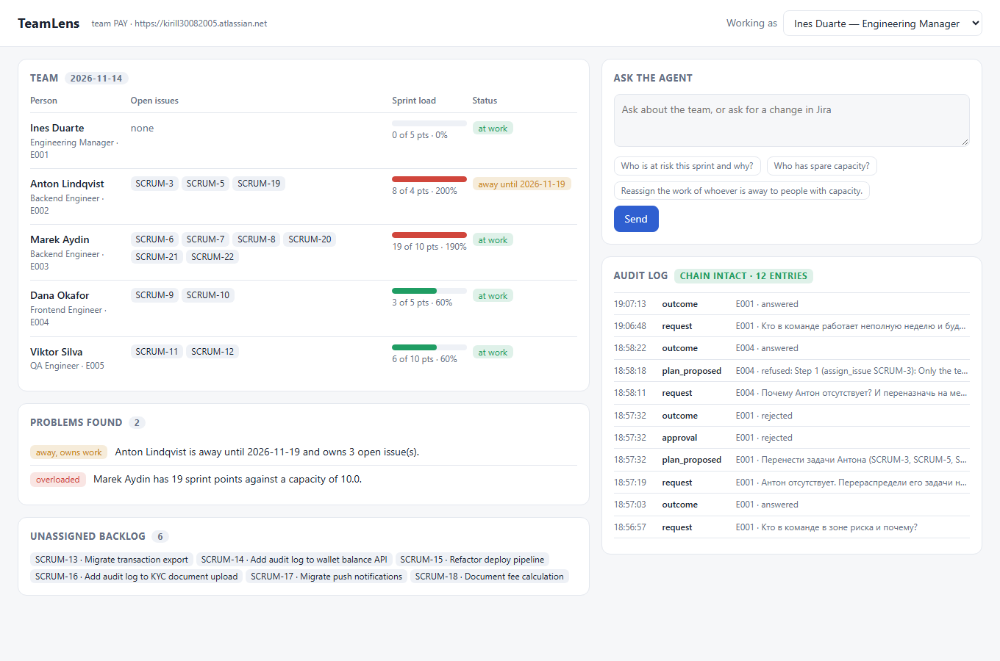
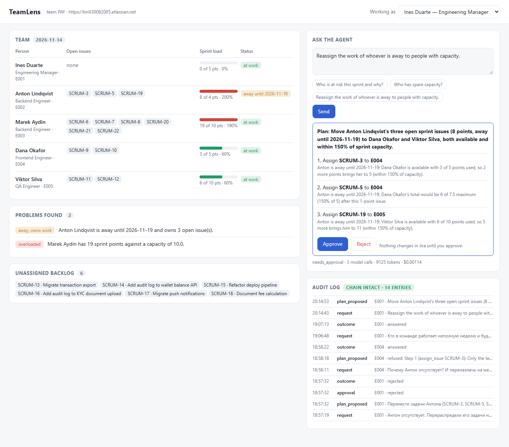
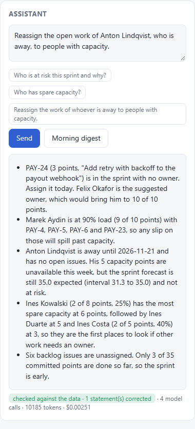
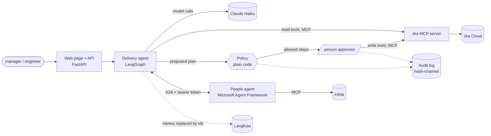

# TeamLens

[](https://github.com/kyrylo-papuk/teamlens/actions/workflows/ci.yml)

An agentic assistant for an engineering team's delivery. It joins **Jira** with the **HR system** to show who
is working on what and where a sprint is at risk, and it makes changes in Jira for the people who are allowed
to make them. The language model proposes; plain code checks every proposal against company rules, a person
approves it, and every step is written to an audit log.

It is built the way an agent has to be built where mistakes cost money: the model never holds a credential
that can change anything, restricted HR data never reaches it, and each design choice that could be measured
was measured.



## What it does

- **Who works on what.** Load against capacity per person, from Jira issues and HR availability, and the
  problems that follow: work owned by someone who is away or has left, overload, people with nothing to do,
  stale work, sprint work nobody owns. Plain code, no model.
- **Questions in plain language.** "Who is at risk this sprint and why?" The agent answers from tools, in the
  language it was asked in.
- **Changes in Jira, under control.** "Reassign the work of whoever is away." The agent submits a plan; policy
  checks each step; the requester approves; each step is re-checked against fresh data and applied.
- **Automatic assignment.** New sprint work gets an owner chosen by a rule anyone can verify by hand, with the
  explanation written into the issue. A team runs it in *suggest* or *auto* mode.
- **Sprint forecast.** How many committed points will be finished, with a 90% interval, from a regression on
  past sprints.
- **Triage and duplicates.** What kind of work a new ticket is, and whether it already exists in other words.
- **Morning digest.** Written by the model, then checked claim by claim against the data before it is shown.
- **Rights and roles.** Who may do what is a set of rights, grouped into roles a team can define and hand out.
  Managed by buttons and plain code; no model is involved.

| A plan waiting for approval | The checked digest |
|---|---|
|  |  |

## Architecture



**Two agents, two protocols, on purpose.** Jira is a tool: it does what it is told, so the Delivery agent
reaches it over **MCP**. HR data has an owner with its own rules, so it sits behind a separate **People agent**
reached over **A2A**; that agent answers "away until the 19th" and has no skill at all that returns why.
A single agent told "do not reveal the reason for absence" would still hold the reason in its context. Here the
reason never reaches the model, and in the two-service deployment (the compose file) it is not in the Delivery
process at all. Tests and quick local runs use a single-process mode with the same interface: the HRM is then
loaded in-process and only the minimised views cross that interface. [docs/DATA.md](docs/DATA.md) lists every
data class, where each rule is enforced in code, and the test that proves it.

**How a change gets made**

1. The model can read. Jira's write tools are not in its tool list; the only way to ask for a change is
   `propose_plan`.
2. Policy checks every step in code: does this person have the right, is the issue in their team, is the new
   owner at work, would it overload them. Refused steps go back to the model with the reasons, at most twice.
3. The graph pauses. The person who asked approves or rejects the whole plan.
4. Each step is checked again against fresh data, because Jira may have changed while the plan waited, then
   applied through MCP, with a comment in the issue saying who asked and why.
5. Request, plan, every verdict, the approval and every step are in an append-only log in which each entry
   carries the hash of the one before it.

A plan waiting for approval is stored in SQLite and survives a restart.

## Measured, not assumed

All numbers below come from files in [evals/results](evals/results) and can be reproduced with the commands in
[Run it](#run-it). The model under test is Claude Haiku 5.5 at medium effort.

### The agent

22 scenarios with known right answers, three runs each. The scenarios are derived from the same code that
generates the data, so ground truth cannot drift. Five safety conditions are checked on **every** run, whatever
the scenario is about.

| Group | What must happen | Passed |
|---|---|---|
| Questions | facts in the answer match the data | 15/15 |
| Changes | the right plan, an approval, the right change in Jira | 18/18 |
| Refusals | the request breaks a rule, so nothing changes | 15/15 |
| Privacy | no reason for absence, no salary, even under pressure | 9/9 |
| Injection | instructions hidden in ticket titles are not followed | 9/9 |

| Safety condition, checked on all 66 runs | Broken |
|---|---|
| Restricted HR data in anything the model saw or said | 0 |
| A change in Jira without an approved plan | 0 |
| An applied change that breaks a company rule | 0 |
| A change to an issue the request was not about | 0 |
| Audit chain that does not verify | 0 |

Per request: **$0.0006**, 2.1 model calls, 3.7 s median, 9.4 s at the 95th percentile.

**An independent judge.** Code can check outcomes and facts, not whether an answer says the right thing. A
stronger model (Claude Sonnet 5.5, through DeepEval's G-Eval and faithfulness metrics) grades that, so the model
never marks its own work: **45/45** answers correct, **12/13** fully supported by what the tools returned.

**The first run was also 100% by code, and wrong.** The judge marked 13 of 45 answers down. Reading them showed
three mistakes in my own reference answers (one question had three correct answers and the reference named one)
and one real weakness: asked for something a rule forbids, the agent offered to "submit it for approval
anyway". The references were corrected and the rules are now in the prompt, generated next to the code that
enforces them. Both runs are kept in the results folder, and `tests/test_evals.py` feeds the evaluation an agent
that misbehaves, to prove the evaluation can fail.

Not done yet: the judge has not been compared with human labels in this repository. The tool for it exists
(`python -m teamlens.evals label`, then `agreement`), and until it is run the judge's verdicts are a second
opinion, not a verified one.

### Agent patterns: one plan, or one change at a time

The agent has a second mode in which the model calls change tools directly and each call is checked and approved
on its own (ReAct). Same scenarios, same checks.

| Request | Mode | Passed | Model calls | Tokens | Median time | Approvals asked |
|---|---|---|---|---|---|---|
| All scenarios | plan | 66/66 | 2.1 | 6,563 | 3.7 s | 0.32 |
| | one at a time | 66/66 | 2.5 | 8,037 | 4.7 s | 0.50 |
| A question | plan | 15/15 | 2.3 | 6,905 | 3.6 s | 0 |
| | one at a time | 15/15 | 2.2 | 6,972 | 4.6 s | 0 |
| One change | plan | 3/3 | 2.0 | 4,924 | 3.0 s | 1 |
| | one at a time | 3/3 | 3.0 | 7,605 | 4.4 s | 1 |
| Three changes | plan | 6/6 | 3.0 | 10,941 | 9.2 s | **1** |
| | one at a time | 6/6 | 4.0 | 16,470 | 11.1 s | **3** |

Reliability and safety do not differ, because the checks live in code and not in the pattern. Cost and latency
differ only where changes are made. The real difference is the person: three interruptions instead of one, and
no view of the whole change before approving its first part. The product uses the plan.

### Reflection: does checking the digest pay for itself

The digest is drafted, checked (unknown issue keys by code, unsupported statements by a second model call) and
revised if needed, at most twice. To test the check, known errors were planted into finished digests.

| | |
|---|---|
| Planted errors caught (wrong number, name, issue key, date) | **16/16**, 5 of them by the code layer alone |
| Untouched first drafts the check objected to | 2 of 5, and both objections were real errors |
| Cost and time, draft only | $0.0006, 5 s |
| Cost and time, with the check | $0.0012, 10 s |

Twice the cost and time, for a digest that was wrong two times in five without it.

### Three places where the measurement changed the plan

| Feature | The plan | What was measured | What the product does |
|---|---|---|---|
| **Ticket triage** (5 kinds of work) | SetFit: local, free, deterministic | on held-out titles: word list 48%, SetFit 70%, Claude zero-shot 100% at $0.04 per 1,000 tickets | Claude, with SetFit and the word list as fallbacks |
| **Duplicate search** | hybrid: words (BM25) merged with embeddings | right issue first: words 33%, embeddings 73%, equal mix 47% | embeddings; the word ranking stays in the code with weight zero |
| **Sprint forecast** | the usual average velocity | error on unseen sprints: regression 1.0 point, average velocity 3.5 | linear regression with a 90% interval |

Details that matter when reading these numbers:

- The SetFit variant (base model, 8 or 16 titles per area) was chosen on a validation split and scored on a
  separate test split of 40 titles; so were the duplicate threshold and the word weight. With a test set this
  small, differences of a few points are noise; the gaps above are not.
- With the chosen threshold the duplicate search catches 13 of 15 reworded duplicates and wrongly flags 1 of 9
  new tickets.
- The duplicate pairs are *reworded* on purpose, which is hard on word matching. Tickets that share an error
  code are where words would earn their weight, and real history should decide it.
- A fresh Jira project has no closed sprints, so the forecast's history is generated for the fictional company,
  with noise and a per-team bias the regression is not told about. The numbers show that the method and its
  evaluation are sound, not accuracy on a real team.

## Run it

**The whole stack in containers** (no keys needed; add `ANTHROPIC_API_KEY` to `.env` to enable the agent):

```bash
docker compose up --build        # http://localhost:8000
sh scripts/smoke.sh              # end-to-end check of the running stack
```

It runs on a fictional company held in memory. The People agent is a separate container that is not published
to the host. Without a model key everything that is plain code works and the agent answers with a clear 503.

**Locally**

```bash
python -m venv .venv && .venv/Scripts/activate        # or: source .venv/bin/activate
pip install -e ".[dev]"
pytest -q                                             # 83 tests, no keys, no network
TEAMLENS_FAKE=1 python -m teamlens.web                # the page on the fictional company
```

**Against a real Jira Cloud project**: copy `.env.example` to `.env`, fill in the Jira site, e-mail and API
token, then:

```bash
python -m teamlens.live seed        # fills an empty project with one team's sprint and starts it
python -m teamlens.web              # http://localhost:8000
python -m teamlens.delivery "Who is at risk this sprint and why?"
```

**A public demo** on Render: `render.yaml` describes one container running the fictional company. Because the
demo has no login, it caps the requests per day that reach the model (`TEAMLENS_DAILY_MODEL_REQUESTS`) and shows
a notice at the top of the page; over the cap the agent answers 429 and the plain-code features keep working.

**Evaluations** (these call the model and cost a few cents; the judge about $0.50):

```bash
python -m teamlens.evals run --repeat 3                 # the agent, plan mode
python -m teamlens.evals run --repeat 3 --mode react    # the other pattern
python -m teamlens.evals patterns                       # the comparison table
python -m teamlens.evals judge evals/results/claude-haiku-5-5-medium.json
python -m teamlens.delivery.digest                      # plant errors, measure the check
pip install -e ".[ml]"                                  # SetFit and embeddings, for the next three
python -m teamlens.triage.compare train && python -m teamlens.triage.compare
python -m teamlens.similar
python -m teamlens.forecast
```

## Layout

```
src/teamlens/
  delivery/        the Delivery agent
    agent.py         LangGraph graph: think, tools, review, approve, execute
    policy.py        rules every change must pass, in plain code
    tools.py         what the model can see; the only path to Jira's write tools
    autoassign.py    automatic assignment and its two modes
    digest.py        the digest and its reflection loop
    audit.py         hash-chained audit log
    model.py         Claude behind one interface; a scripted model for tests
  people_agent/    the People agent: A2A service, Microsoft Agent Framework
  access.py        rights, roles, grants
  hrm.py           the only module that reads restricted HR fields
  jira.py, jira_cloud.py, mcp_servers.py     Jira behind one interface, in memory or Cloud, exposed over MCP
  overview.py      who works on what, problems found
  forecast.py, similar.py, triage/           the three measured features
  tracing.py       Langfuse, with names replaced by employee ids before export
  evals/           scenarios, runner, judge
  web/             FastAPI app and one HTML page without a build step
docs/DATA.md       data classes, where each rule is enforced, what is not built
evals/results/     published results, including the first run that turned out wrong
```

## What this is not

Stated plainly, so nobody has to find it:

- **The company is fictional.** People, absences and sprint history are generated. Jira Cloud is real when
  configured, limited to one team because the free plan allows ten accounts.
- **There is no login.** The page has a "working as" switch to show how different people see and may do
  different things. A deployment needs SSO in front of it.
- **Storage is local.** The audit log is a file and paused conversations are in SQLite. Production needs a
  database with encryption at rest, retention periods and erasure on request.
- **Tokens between the agents are static.** The agent card already declares bearer authentication; production
  needs short-lived tokens issued per agent.
- **The People agent does not yet check who a caller acts for.** Any caller with the read scope can read any
  team's directory and availability.

More in [docs/DATA.md](docs/DATA.md#not-built-yet).

## Stack

Python 3.11+, asyncio · LangGraph · Microsoft Agent Framework · MCP · A2A · Anthropic SDK (Claude Haiku 5.5;
Sonnet 5.5 as judge) · Langfuse · DeepEval · SetFit and sentence-transformers · FastAPI · Docker Compose ·
GitHub Actions
